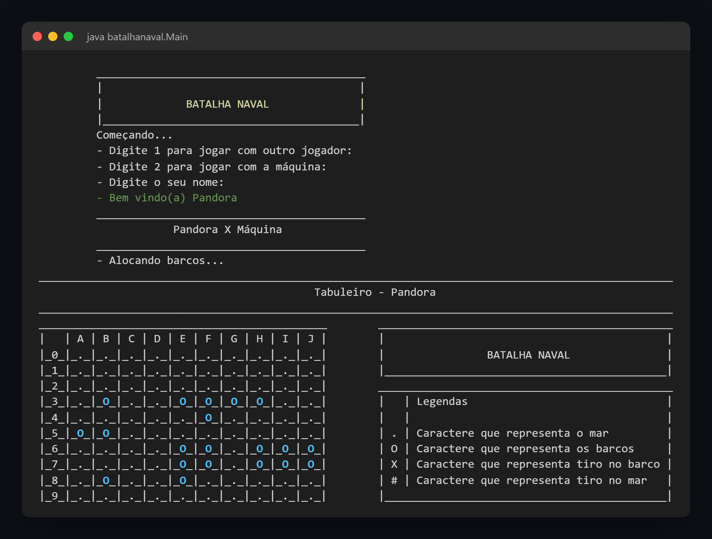
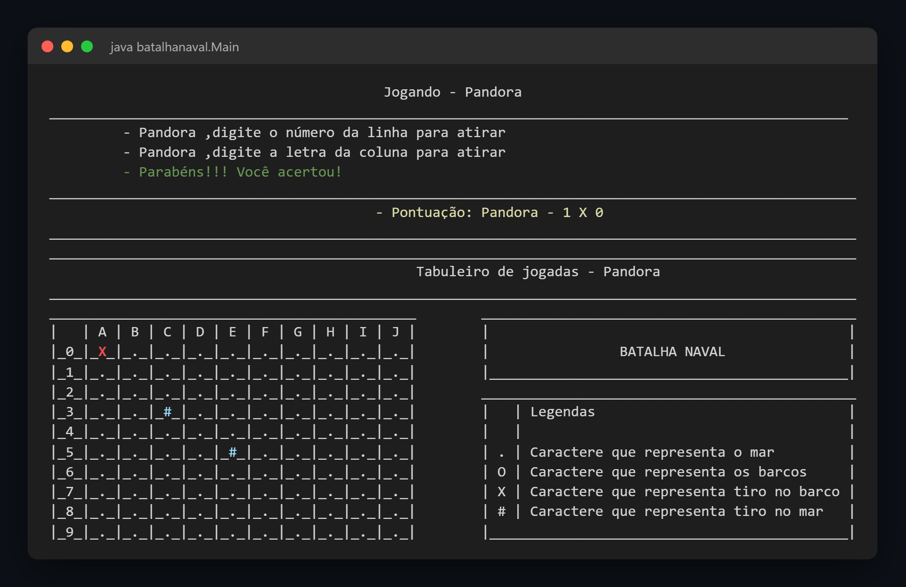

# Batalha Naval

[](LICENSE)

Jogo de Batalha Naval para o terminal feito em Java, com partidas entre dois jogadores ou contra a máquina, tabuleiro 10x10 desenhado em texto e placar a cada jogada.

> **Projeto de estudo (2023):** criado durante meus estudos de Java para praticar lógica de programação, matrizes, laços, classes e leitura de dados pelo terminal, mantido aqui para mostrar minha evolução como desenvolvedora.

<p align="center">
  
</p>

<p align="center"><em>Menu inicial e tabuleiro com os barcos posicionados</em></p>

<p align="center">
  
</p>

<p align="center"><em>Tiro certeiro, placar e tabuleiro de jogadas</em></p>

## Funcionalidades

- Modo para dois jogadores, no mesmo terminal
- Modo contra a máquina, que posiciona os barcos e atira aleatoriamente
- Posicionamento dos barcos manual, escolhendo linha, coluna e orientação, ou automático
- Frota de 10 barcos: 1 de 4 espaços, 2 de 3, 3 de 2 e 4 de 1
- Validação de posições fora do tabuleiro, barcos sobrepostos e tiros repetidos
- Tabuleiro de jogadas com acertos (`X`) e tiros na água (`#`)
- Placar atualizado a cada jogada
- Opção de começar uma nova partida ao final

## Tecnologias

- [Java](https://www.java.com/) - linguagem do jogo
- `Scanner` - leitura das jogadas pelo terminal
- `Random` - posicionamento dos barcos e jogadas da máquina

## Como Executar

### Pré-requisitos

Antes de começar, tenha instalado o [JDK](https://adoptium.net/) 8 ou superior.

### Instalação

Clone o repositório:

```bash
git clone https://github.com/Plovatto/BatalhaNaval.git
```

Acesse a pasta do projeto:

```bash
cd BatalhaNaval
```

Compile o código:

```bash
javac -encoding UTF-8 -d out batalhanaval/*.java
```

Inicie o jogo:

```bash
java -cp out batalhanaval.Main
```

As linhas são informadas por número (`0` a `9`) e as colunas por letra (`A` a `J`).

## Estrutura do Projeto

```text
├── batalhanaval/
│   ├── Main.java             # Menu inicial e escolha do modo de jogo
│   ├── JogoManual.java       # Dois jogadores com posicionamento manual dos barcos
│   ├── JogoAutomatico.java   # Dois jogadores com posicionamento automático dos barcos
│   └── JogoMaquina.java      # Partida contra a máquina
└── docs/                     # Imagens usadas neste README
```

## Licença

Distribuído sob a [Licença MIT](LICENSE).
